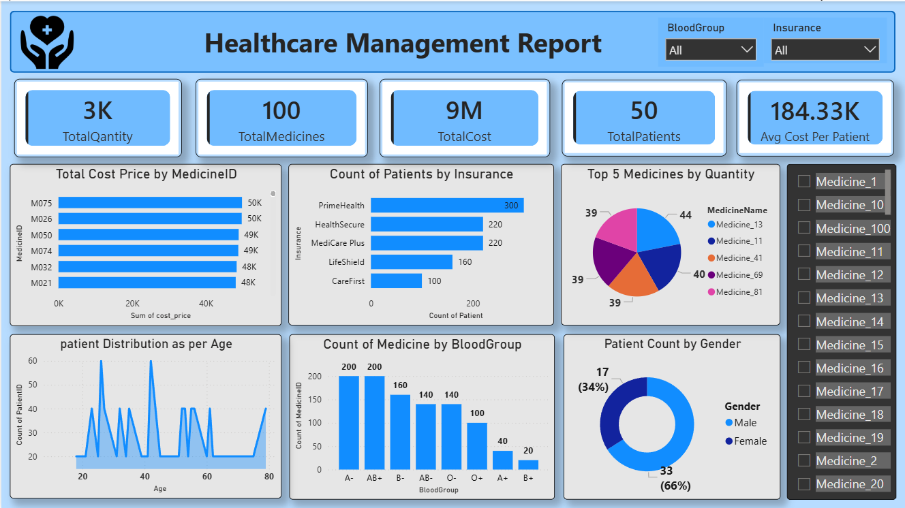

# Healthcare_Inventary_Report_PowerBI

The Healthcare Management Dashboard provides a consolidated view of healthcare data to support data analysis and operational decision-making. It transforms healthcare records into meaningful insights through KPI cards, charts, and interactive filters.

The dashboard enables Client to explore patient distribution, medicine consumption, insurance coverage, blood group statistics,Relationship and healthcare expenditure in a single interface.

##Project Objectives

Monitor key healthcare performance indicators.
Analyze total medicine quantities and medicine inventory usage.
Evaluate healthcare costs and average cost per patient.
Understand patient distribution across insurance providers.
Explore patient demographics by age and gender.
Analyze medicine distribution across different blood groups.
Enable interactive data exploration through filters and medicine selection.

📊 Dashboard Preview

Healthcare Management Dashboard featuring KPI cards, interactive filters, and healthcare analytics visualizations.

📈 Key Performance Indicators (KPIs)

The dashboard highlights five key metrics:

KPI	Description
Total Quantity	Total quantity of medicines recorded
Total Medicines	Number of medicines represented in the dataset
Total Cost	Aggregate healthcare or medicine cost
Total Patients	Number of patients represented in the analysis
Average Cost per Patient	Average healthcare cost per patient
The values displayed in the dashboard represent the current dataset and may change when filters are applied.

📉 Visualizations and Insights

1. Total Cost by Medicine ID - 
Compares total costs across medicine identifiers.
Highlights medicines associated with higher expenditure.
Helps identify medicine cost patterns.

3. Patient Count by Insurance Provider - 
Compares patient counts across insurance providers.
Identifies providers with higher patient representation.
Supports analysis of insurance distribution.

4. Top 5 Medicines by Quantity - 
Displays the five leading medicines by quantity.
Compares their relative contribution to total medicine usage.
Helps identify frequently used medicines.

5. Patient Distribution by Age - 
Visualizes patient counts across different age groups.
Helps explore age-related patterns within the dataset.

6. Medicine Count by Blood Group - 
Compares medicine records or counts across blood groups.
Highlights the distribution of medicine-related records by blood group.

7. Patient Count by Gender - 
Shows the distribution of patients by gender.
Presents both absolute counts and percentage contributions.

🎛️ Interactive Features

Blood Group Filter: Filter dashboard data by blood group.

Insurance Filter: Explore metrics for selected insurance providers.

Medicine Selection: Select individual medicines to explore relevant data.

Cross-Visual Analysis: Use available dashboard interactions to investigate relationships between healthcare metrics.
